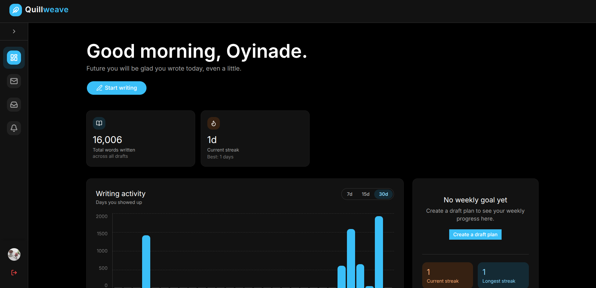
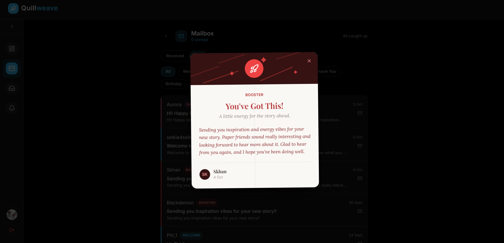

# Quillweave Backend

The server behind **Quillweave**, a website that helps writers set goals for their drafts, track their progress, sprint, and send each other encouragement cards.

**Live site:** [quillweave.com.ng](https://quillweave.com.ng/) · **Frontend repo:** [add link]

## What It Does

- Registers writers and signs them in securely
- Tracks each writer's draft goals, and their daily, weekly, and overall progress
- Tracks writing schedules and bonus days, and sends automatic reminders
- Stores sprint data, with live word counts and a Sprint Room for writing together
- Stores and delivers encouragement and greeting cards between writers

## Tech Stack

- **Node.js** and **Express** for the REST API
- **Prisma ORM** with **PostgreSQL on Supabase** for the database and storage
- **JWT** for authentication
- **Socket.IO** for live sprint updates
- **node-cron** for scheduled reminders
- **Render** for hosting

## Running Locally

This server needs a Supabase project and several environment variables, so it isn't set up as a one-command install. To see it in action, visit the live site above.

## Roadmap

- [ ] Clean up unused files and dependencies

## What I Learned

- How a backend and frontend work together, and how development and production environments differ
- How to validate user input so bad data never reaches the database
- How to design data and features around real users